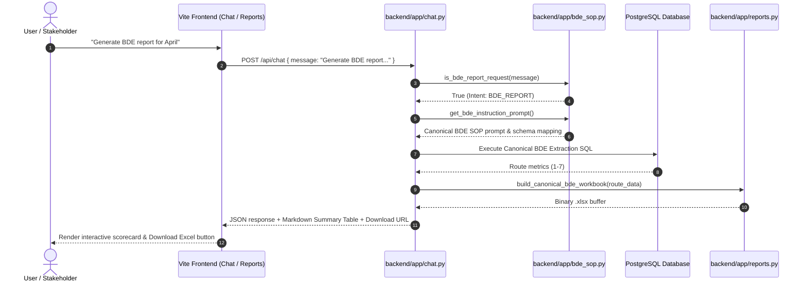

# System Architecture & AI Instruction Layer: BDE Performance Report

## Document Control
- **Document ID:** ARCH-BDE-001
- **Associated SOP:** SOP-BDE-001 (`BDE_Report.md`)
- **System Role:** AI Instruction Layer Integration & Dynamic Knowledge Discovery
- **Architecture Pattern:** Decoupled SOP Specification & Code-Engine Synthesis

---

## 1. Architectural Philosophy

Traditional reporting systems hardcode SQL queries, cell coordinates, and formulas directly inside application code. When report layouts or business logic change, developers must refactor code across multiple files.

The **Horeca Sales Intelligence Architecture** decouples the reporting system into four distinct layers:

```
+-----------------------------------------------------------------------------------+
| 1. SPECIFICATION LAYER (Canonical SOPs in /docs/report_standards/)                |
|    - BDE_Report.md, BusinessRules.md, FormulaReference.md, FieldMappings.md       |
|    - Human-readable & Machine-actionable Markdown SOPs                            |
+-----------------------------------------------------------------------------------+
                                         │  Loaded dynamically on demand
                                         ▼
+-----------------------------------------------------------------------------------+
| 2. AI INSTRUCTION LAYER (backend/app/bde_sop.py & prompt injection)              |
|    - Dynamically injects SOP instructions into LLM system prompts                 |
|    - Guides LLM intent detection, parameter extraction, and report planning      |
+-----------------------------------------------------------------------------------+
                                         │  Parameter resolution & SQL dispatch
                                         ▼
+-----------------------------------------------------------------------------------+
| 3. DATA & SECURITY LAYER (PostgreSQL & SQL Validator)                            |
|    - Read-only parameterized query execution                                      |
|    - Extracts live transactional figures for Routes 1 to 7                        |
+-----------------------------------------------------------------------------------+
                                         │  Extracted rows & targets
                                         ▼
+-----------------------------------------------------------------------------------+
| 4. EXCEL GENERATION ENGINE (backend/app/reports.py via OpenPyXL)                 |
|    - Compiles pixel-perfect .xlsx workbook with live Excel formulas               |
|    - Delivers downloadable binary and UI card                                     |
+-----------------------------------------------------------------------------------+
```

---

## 2. Component Interactions



---

## 3. Dynamic Instruction Layer Integration

The AI instruction layer does not hardcode prompts inside Python string literals. Instead, `backend/app/bde_sop.py` serves as a dynamic loader:

1. **Lazy-Loading & Caching:** Reads markdown documents from `docs/report_standards/` at startup or on first request, caching them in memory for sub-millisecond access.
2. **Context-Aware Injection:** When `chat.py` receives a user question relating to BDE performance, retention rates, route volumes, or sales targets, the relevant SOP context is injected directly into the LLM system prompt.
3. **Guardrail Enforcement:** The instruction layer explicitly instructs the LLM that `4.BDE Report.xlsx` was a specification template—the LLM must never make up sample numbers, and must instruct the execution engine to generate live Excel formulas.

---

## 4. Extensibility & Future Maintainability

This architecture allows commercial teams to modify or introduce reports without refactoring backend code:

### Modifying an Existing Metric
- *Example:* Changing the retention SLA from 93% to 95%.
- *Action:* Update `E2` in `docs/report_standards/BusinessRules.md` and `FormulaReference.md`. The instruction layer automatically loads the updated SLA.

### Adding New Routes
- *Example:* Expanding the territory to include Route 8 and Route 9.
- *Action:* Update `routes AS (SELECT generate_series(1, 9))` in `FieldMappings.md` and adjust row offsets in `FormulaReference.md`.

### Adding a New Report Type
- *Example:* Adding a "Van Sales Route Audit" report.
- *Action:* Create `docs/report_standards/Van_Sales_Report.md`, register the intent in `backend/app/bde_sop.py`, and implement the corresponding OpenPyXL layout.
