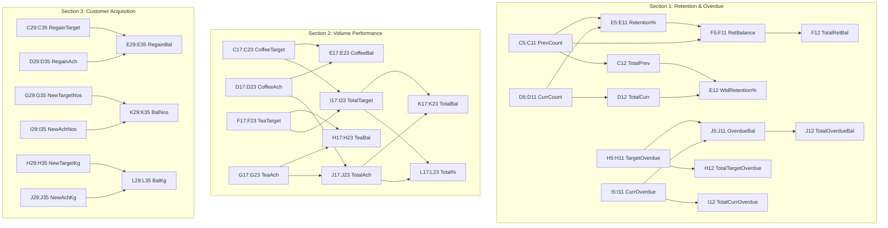

# Formula Reference & Dependency Map: BDE Performance Report

## Document Control
- **Document ID:** FR-BDE-001
- **Associated SOP:** SOP-BDE-001 (`BDE_Report.md`)
- **Canonical Specification Source:** `4.BDE Report.xlsx`
- **Application:** Excel Generation Engine, SQL Aggregator, Calculation Verifier

---

## 1. Complete Coordinate Grid (36 Rows × 12 Columns)

The canonical BDE report operates strictly within the coordinate boundary of **Columns B to L** and **Rows 1 to 36**. Column A is a 9.14-width empty margin spacer.

```
      B         C         D         E         F         G         H         I         J         K         L
1  [Title]   .         .         .         .         .         .         .         .         .         .
2  .         .         .     [Threshold]   .         .         .         .         .         .         .
3  [BDE Rte] [----- RETENTION -----]                 .         [-- OVERDUE --]       .         .         .
4  [       ] PrevCount CurrCount Retention% RetBalance .       Target    Current   Balance   .         .
5  Route 1     data      data     =D5/C5    =ROUNDUP.. .        data      data     =I5-H5    .         .
..
11 Route 7     data      data     =D11/C11  =ROUNDUP.. .        data      data     =I11-H11  .         .
12 TOTAL       =SUM      =SUM     =D12/C12  =SUM       .        =SUM      =SUM     =SUM      .         .
13 [empty]
14 [empty]
15 [BDE Rte] [--- COFFEE ---]     .         [---- TEA ----]     [----------- TOTAL -----------]
16 [       ] Target  Achieved Balance Target  Achieved Balance Target  Achieved Balance   %
17 Route 1     data      data     =D17-C17   data      data     =G17-F17 =C17+F17 =D17+G17 =J17-I17 =J17/I17
..
23 Route 7     data      data     =D23-C23   data      data     =G23-F23 =C23+F23 =D23+G23 =J23-I23 =J23/I23
24 TOTAL       =SUM      =SUM     =D24-C24  =SUM      =SUM     =G24-F24 =SUM     =SUM     =SUM     =J24/I24
25 [empty]
26 [empty]
27 [BDE Rte] [--- REGAIN ---]     .         .         [--------------- NEW CUSTOMERS ---------------]
28 [       ] Target  Achieved Balance .     TargetNos TargetKg AchNos    AchKg    BalNos    BalKg
29 Route 1     data      data     =D29-C29 .     data      data     data      data     =I29-G29 =J29-H29
..
35 Route 7     data      data     =D35-C35 .     data      data     data      data     =I35-G35 =J35-H35
36 TOTAL       =SUM      =SUM     =SUM     .     =SUM      =SUM     =SUM      =SUM     =SUM     =SUM
```

---

## 2. Section 1: Retention & Overdue Formulas (Rows 1–12)

### 2.1 Configuration Constant
- **Coordinate:** `E2`
- **Canonical Content:** `0.93` (Numeric constant representing 93% SLA retention threshold)

### 2.2 Data Rows (Routes 1–7: Rows $r = 5$ to $11$)
| Col | Field Label | Content / Formula | Formula Syntax | Dependency / Inputs | Number Format |
| :--- | :--- | :--- | :--- | :--- | :--- |
| **B** | BDE Route Nos | Integer $1 \dots 7$ | Static value | Database route number | `General` |
| **C** | Prev Month Count | Active customer count | Static fetched | Distinct purchasing customers in $M_{-1}$ | `#,##0` |
| **D** | Current Month Count | Retained customer count | Static fetched | Distinct purchasing customers in $M_0$ from $M_{-1}$ | `#,##0` |
| **E** | Percentage | Ratio of retention | `=+D{r}/C{r}` | Depends on $D{r}, C{r}$ | `0.00%` |
| **F** | Balance | Headcount deficit/surplus | `=ROUNDUP((E{r}-0.93)*C{r},0)` | Depends on $E{r}, C{r}$, constant `0.93` | `#,##0` |
| **G** | *Spacer* | Blank | None | Column width 10.71 | `General` |
| **H** | Target | Target overdue recovery | Static fetched | Monthly recovery target (INR) | `_ * #,##0_ ;...` |
| **I** | Current | Actual overdue collected | Static fetched | Collected overdue arrears (INR) | `_ * #,##0_ ;...` |
| **J** | Balance | Collection variance | `=+I{r}-H{r}` | Depends on $I{r}, H{r}$ | `_ * #,##0_ ;...` |

### 2.3 Total Summary Row (Row 12)
| Cell | Field Label | Formula | Description |
| :--- | :--- | :--- | :--- |
| **B12** | Label | `"TOTAL"` | Bold text |
| **C12** | Total Prev Month | `=SUM(C5:C11)` | Portfolio previous month customer baseline |
| **D12** | Total Current Month | `=SUM(D5:D11)` | Portfolio current retained customer count |
| **E12** | Weighted Retention % | `=+D12/C12` | True portfolio retention rate ($1390/1787 = 77.78\%$) |
| **F12** | Total Retention Balance| `=SUM(F5:F11)` | Net portfolio account deficit/surplus |
| **H12** | Total Overdue Target | `=SUM(H5:H11)` | Portfolio collection quota (INR) |
| **I12** | Total Overdue Current| `=SUM(I5:I11)` | Portfolio total collected (INR) |
| **J12** | Total Overdue Balance| `=SUM(J5:J11)` | Portfolio net collection variance |

---

## 3. Section 2: Volume Performance Formulas (Rows 15–24)

### 3.1 Data Rows (Routes 1–7: Rows $r = 17$ to $23$)
| Col | Field Label | Content / Formula | Formula Syntax | Dependency / Inputs | Number Format |
| :--- | :--- | :--- | :--- | :--- | :--- |
| **B** | BDE Route Nos | Integer $1 \dots 7$ | Static value | Route index | `General` |
| **C** | Coffee Target | Target KG | Static fetched | Monthly Coffee quota (KG) | `#,##0` |
| **D** | Coffee Achieved | Actual KG sold | Static fetched | MTD Coffee sales volume (KG) | `#,##0.0` or `0` |
| **E** | Coffee Balance | Variance (KG) | `=+D{r}-C{r}` | Depends on $D{r}, C{r}$ | `#,##0.0` |
| **F** | Tea Target | Target KG | Static fetched | Monthly Tea quota (KG) | `#,##0` |
| **G** | Tea Achieved | Actual KG sold | Static fetched | MTD Tea sales volume (KG) | `#,##0.0` or `0` |
| **H** | Tea Balance | Variance (KG) | `=+G{r}-F{r}` | Depends on $G{r}, F{r}$ | `#,##0.0` |
| **I** | Total Target | Combined Target (KG) | `=+C{r}+F{r}` | Sum of Coffee & Tea Target | `#,##0` |
| **J** | Total Achieved | Combined Achieved (KG) | `=+D{r}+G{r}` | Sum of Coffee & Tea Achieved | `#,##0.0` |
| **K** | Total Balance | Combined Variance (KG) | `=+J{r}-I{r}` | Total Achieved - Total Target | `#,##0.0` |
| **L** | Total % | Realization rate | `=+J{r}/I{r}` | Total Achieved / Total Target | `0%` |

### 3.2 Total Summary Row (Row 24)
| Cell | Field Label | Formula | Description |
| :--- | :--- | :--- | :--- |
| **B24** | Label | `"TOTAL"` | Bold text |
| **C24** | Total Coffee Target | `=SUM(C17:C23)` | Portfolio Coffee quota |
| **D24** | Total Coffee Achieved| `=SUM(D17:D23)` | Portfolio Coffee sales volume |
| **E24** | Total Coffee Balance | `=+D24-C24` | Total Achieved - Total Target (or `=SUM(E17:E23)`) |
| **F24** | Total Tea Target | `=SUM(F17:F23)` | Portfolio Tea quota |
| **G24** | Total Tea Achieved | `=SUM(G17:G23)` | Portfolio Tea sales volume |
| **H24** | Total Tea Balance | `=+G24-F24` | Total Achieved - Total Target (or `=SUM(H17:H23)`) |
| **I24** | Combined Total Target| `=SUM(I17:I23)` | Portfolio combined quota |
| **J24** | Combined Total Achieved| `=SUM(J17:J23)` | Portfolio combined sales |
| **K24** | Combined Total Balance | `=SUM(K17:K23)` | Net volume variance |
| **L24** | Portfolio Achievement %| `=+J24/I24` | Weighted achievement ratio |

---

## 4. Section 3: Customer Acquisition Formulas (Rows 27–36)

### 4.1 Data Rows (Routes 1–7: Rows $r = 29$ to $35$)
| Col | Field Label | Content / Formula | Formula Syntax | Dependency / Inputs | Number Format |
| :--- | :--- | :--- | :--- | :--- | :--- |
| **B** | BDE Route Nos | Integer $1 \dots 7$ | Static value | Route index | `General` |
| **C** | Target Regain Cust | Regain quota (Nos) | Static fetched | Target recovered accounts | `#,##0` |
| **D** | Regain Achieved | Recovered accounts | Static fetched | Actual reactivated accounts | `#,##0` |
| **E** | Regain Balance | Account variance | `=+D{r}-C{r}` | Depends on $D{r}, C{r}$ | `#,##0` |
| **F** | *Spacer* | Blank | None | Separator | `General` |
| **G** | New Cust Target Nos | New account quota | Static fetched | Target new accounts | `#,##0` |
| **H** | New Cust Target Qty | New account quota (KG)| Static fetched | Target volume from new accounts | `#,##0` |
| **I** | New Cust Achieved Nos| New accounts opened | Static fetched | Actual new accounts opened | `#,##0` |
| **J** | New Cust Achieved Qty| New accounts volume (KG)| Static fetched | Actual volume sold to new accounts | `#,##0.0` |
| **K** | Balance in Nos | Account variance | `=+I{r}-G{r}` | Depends on $I{r}, G{r}$ | `#,##0` |
| **L** | Balance in Kgs | Volume variance (KG) | `=+J{r}-H{r}` | Depends on $J{r}, H{r}$ | `#,##0.0` |

### 4.2 Total Summary Row (Row 36)
| Cell | Field Label | Formula | Description |
| :--- | :--- | :--- | :--- |
| **B36** | Label | `"TOTAL"` | Bold text |
| **C36** | Total Regain Target | `=SUM(C29:C35)` | Portfolio regain quota |
| **D36** | Total Regain Achieved| `=SUM(D29:D35)` | Total reactivated accounts |
| **E36** | Total Regain Balance | `=SUM(E29:E35)` | Net regain variance |
| **G36** | Total New Cust Target Nos | `=SUM(G29:G35)` | Portfolio new account quota |
| **H36** | Total New Cust Target Qty | `=SUM(H29:H35)` | Portfolio new volume quota |
| **I36** | Total New Cust Achieved Nos| `=SUM(I29:I35)` | Total new accounts opened |
| **J36** | Total New Cust Achieved Qty| `=SUM(J29:J35)` | Total volume from new accounts |
| **K36** | Total Balance in Nos | `=SUM(K29:K35)` | Net new account variance |
| **L36** | Total Balance in Kgs | `=SUM(L29:L35)` | Net new account volume variance |

---

## 5. Dependency & Execution Graph


